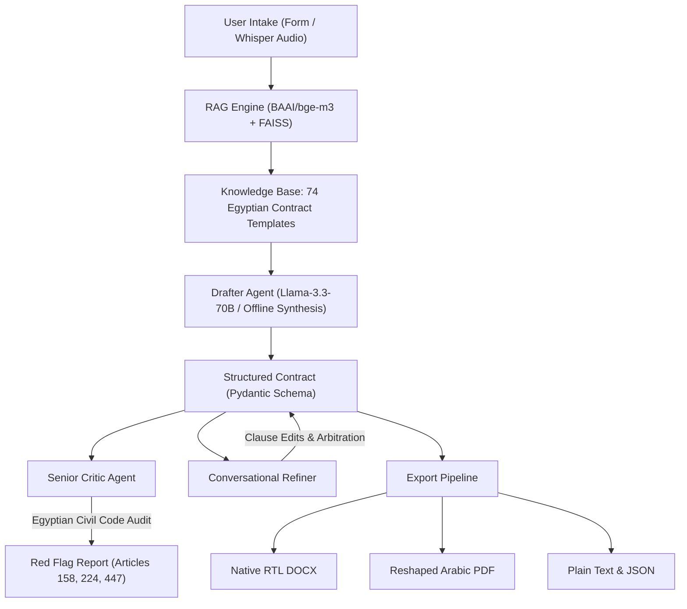

# ⚖️ Egyptian Legal Contract AI (Multi-Agent RAG System)
### المنظومة الذكية لصياغة ومراجعة وتدقيق العقود المصرية

[](https://www.python.org/)
[](https://streamlit.io/)
[](https://github.com/facebookresearch/faiss)
[](https://drive.google.com/file/d/1f7iz25Hz7y1FoSQAWTeCEMsndHWFB_Qr/view?usp=sharing)
[](LICENSE)

An enterprise-grade, domain-specific **Multi-Agent AI legal assistant** tailored specifically for Egyptian civil and commercial law. The system automates end-to-end contract drafting, risk auditing, clause-level natural language editing, and professional document rendering (RTL Word & PDF).

> 🎥 **Live Working Video Demo:** [Watch Full Demo on Google Drive](https://drive.google.com/file/d/1f7iz25Hz7y1FoSQAWTeCEMsndHWFB_Qr/view?usp=sharing)

---

## 🌟 Key Highlights

- **🤖 Multi-Agent Pipeline:**
  - **Drafter Agent:** Synthesizes structured, enforceable Egyptian contracts following strict Pydantic schemas.
  - **Senior Critic Agent:** Acts as opposing counsel to detect one-sided terms, missing provisions, and statutory violations against the **Egyptian Civil Code (Law 131/1948)** and Commercial Code (Law 17/1999).
  - **Conversational Refiner:** Enables granular, clause-level contract modifications using natural Arabic conversational prompts (e.g., adding CRCICA arbitration, adjusting liquidated damages).
- **📚 Domain-Specific RAG Engine:** Semantic retrieval over a curated knowledge base of **74 authentic Egyptian contract templates** (`.docx` & legacy `.doc`) using multilingual `BAAI/bge-m3` embeddings and `FAISS` indexing.
- **🛡️ Dual Execution Modes:**
  - **Offline Demo Mode:** Instant, deterministic high-fidelity legal generation with zero setup or API keys required (ideal for offline demos, portfolios, and CI/CD).
  - **Groq Cloud LLM Mode:** Ultra-fast cloud inference powered by `llama-3.3-70b-versatile` and `whisper-large-v3`.
- **📄 Multi-Format RTL Export:**
  - **Microsoft Word (DOCX):** Native RTL alignment (`w:bidi`), custom margins, and styled signature tables.
  - **Print-Ready PDF:** Pre-shaped Arabic glyphs using `arabic-reshaper` and bidirectional text ordering via `python-bidi`.
  - **JSON Schema:** Raw structured export for legal databases and integrations.
- **🎤 Arabic Voice Dictation:** Whisper-powered speech-to-text intake for special terms and legal annotations.

---

## 🏛️ System Architecture



---

## 🚀 Quick Start

### 1. Clone & Set Up Environment

```bash
git clone https://github.com/Zeyad-elsawi/Arabic-Contract-Generator.git
cd Arabic-Contract-Generator
```

Create and activate a virtual environment:

```bash
python -m venv venv
# On Windows:
venv\Scripts\activate
# On Linux/macOS:
source venv/bin/activate
```

### 2. Install Dependencies

```bash
pip install -r requirements.txt
```

### 3. Launch the Application

```bash
streamlit run app.py
```

The application will launch locally at **`http://localhost:8501`**.

---

## ⚙️ Configuration & API Keys

The application works completely out-of-the-box in **Offline Demo Mode**.

To enable Cloud AI inference:
1. Obtain a free API key from [Groq Console](https://console.groq.com/keys).
2. Enter the key directly in the Streamlit sidebar at runtime, **OR** add it to `.streamlit/secrets.toml`:
```toml
GROQ_API_KEY = "your_groq_api_key_here"
```

---

## 📂 Project Structure

```
Arabic-Contract-Generator/
├── app.py                  # Main Streamlit web application & RTL interface
├── agents.py               # Multi-agent coordination: Drafter, Critic, Refiner
├── mock_engine.py          # High-fidelity Egyptian legal synthesis engine (Offline/Demo)
├── config.py               # Central paths, model IDs, and runtime settings
├── llm.py                  # Groq client wrappers (streaming & Whisper audio)
├── prompts.py              # Arabic system prompts & statutory legal templates
├── schema.py               # Pydantic data models for contracts & critique reports
├── rag.py                  # FAISS retrieval & BAAI/bge-m3 embedding pipeline
├── templates.py            # DOCX & legacy DOC (OLE2) template parsers
├── export.py               # RTL DOCX & Arabic-reshaped PDF document renderers
├── requirements.txt        # Python package dependencies
├── vector_db/              # Persisted FAISS index & metadata
│   ├── egyptian_contracts.faiss
│   └── egyptian_contracts.meta.json
└── نماذج عقود/مصري - Copy/ # 74 Authentic Egyptian legal templates
```

---

## ⚖️ Supported Contract Categories

The RAG index covers authentic Egyptian legal templates across major categories:
- **عقود البيع (Sales Contracts):** Real estate, apartments, commercial shops, vehicles, shares, and agricultural land.
- **عقود الإيجار (Lease Contracts):** Residential, commercial, advertising, and equipment leases.
- **عقود المقاولة (Construction & Contracting):** General contracting, subcontracting, and engineering design agreements.
- **عقود الوكالة والتوكيل (Agency & Powers of Attorney):** Commercial agency, commission agreements, and real estate mandates.
- **عقود الهبة والقسمة (Donation & Partition):** Asset partition, property gifting with/without consideration.
- **عقود متخصصة (Specialized Contracts):** Franchising, publishing, NDAs/confidentiality, and legal retainer agreements.

---

## 🛡️ Legal Compliance & Disclaimer

The drafting and review logic incorporates principles from:
- **Egyptian Civil Code (Law No. 131 of 1948)**
- **Egyptian Commercial Code (Law No. 17 of 1999)**
- **Real Estate Registration Law (Law No. 114 of 1946)**
- **Egyptian Arbitration Law (Law No. 27 of 1994)**

*Disclaimer: Contracts generated by this platform serve as automated preliminary drafts and should be reviewed by a licensed Egyptian attorney prior to formal execution.*

---

## 📄 License

This project is licensed under the MIT License.
